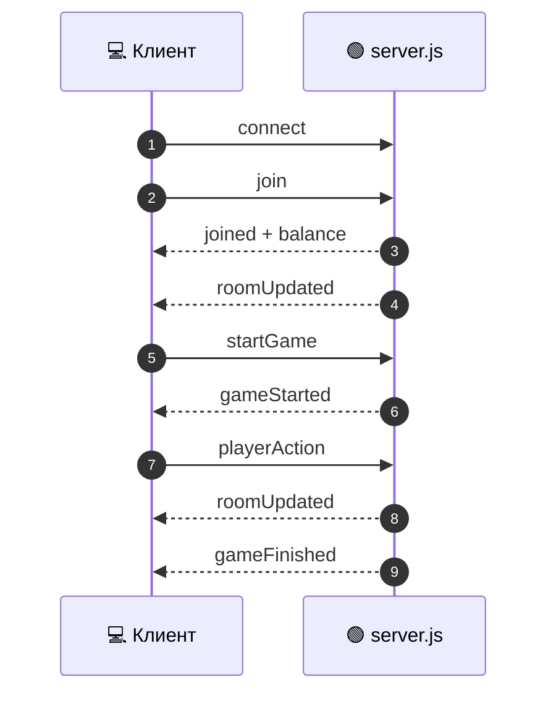

<a id="top"></a>
<div align="center">



<a href="README.md">
  
</a>

<br/>

<a href="README.md"></a>
<a href="ARCHITECTURE.md"></a>
<a href="DEPLOY.md"></a>
<a href="API.md"></a>

</div>

---

Базовый адрес по умолчанию: `http://localhost:3000`.

---

## 🌐 HTTP API

### `GET /health`

Проверка состояния сервера и базы.

```json
{
  "status": "ok",
  "timestamp": "2026-11-09T12:00:00.000Z",
  "rooms": 2,
  "players": 5,
  "db": "ok"
}
```

При ошибке БД: `503 { "status": "error", "db": "..." }`.

---

### `GET /api/rooms`

Список активных комнат **без скрытых карт**.

```json
[
  {
    "id": "A1B2C3",
    "gameType": "blackjack",
    "bet": 100,
    "maxPlayers": 4,
    "status": "waiting",
    "createdAt": 1762689600000,
    "players": [
      { "id": 123456789, "name": "Игрок", "connected": true }
    ]
  }
]
```

`status` может быть `waiting`, `playing` или `finished`.

---

### `GET /api/stats`

Публичная статистика.

```json
{
  "totalRooms": 2,
  "online": 5,
  "totalUsers": 12,
  "totalGames": 34,
  "uptime": 3600.5
}
```

---

### `GET /api/user/:id`

Публичные данные пользователя по ID.

```json
{
  "id": 123456789,
  "username": "player",
  "first_name": "Игрок",
  "balance": 1000,
  "points": 2000
}
```

Если пользователь не найден — `404 { "error": "not found" }`.

> Гости сайта без Telegram получают отрицательный ID.  
> Пользователи Telegram Mini App используют настоящий Telegram ID и общий баланс с ботом.

---

### `GET /tma/init`

Данные темы для Telegram Mini App.

```json
{
  "bot": "casinobot",
  "theme": {
    "bg_color": "#0f172a",
    "text_color": "#ffffff",
    "hint_color": "#94a3b8",
    "link_color": "#3b82f6",
    "button_color": "#3b82f6",
    "button_text_color": "#ffffff"
  }
}
```

---

## 🔌 Socket.io

Подключение:

```javascript
const socket = io();
```



### Клиент → сервер

| Событие | Данные | Описание |
|---------|--------|----------|
| `join` | `{ userId, userName, roomId?, gameType?, bet?, maxPlayers? }` | Войти в комнату или создать новую |
| `startGame` | — | Начать игру (только создатель, минимум 2 игрока) |
| `rematch` | — | Перезапустить завершённую игру (только создатель) |
| `playerAction` | `{ action, cardId? }` | Игровой ход |
| `leaveRoom` | — | Выйти из комнаты |
| `adminLogin` | `{ password }` | Вход в админ-панель |
| `adminStats` | — | Статистика для админки |
| `adminTransactions` | — | Последние 50 транзакций |
| `adminAdjustBalance` | `{ userId, delta, reason? }` | Изменить баланс игрока |
| `adminCloseRoom` | `{ roomId }` | Закрыть комнату (ставки вернутся) |
| `adminBroadcast` | `{ message }` | Отправить сообщение всем онлайн-игрокам |

#### Действия `playerAction`

| Игра | `action` | `cardId` | Смысл |
|------|----------|----------|-------|
| `blackjack` | `hit` | — | Взять карту |
| `blackjack` | `stand` | — | Остановиться |
| `durak` | `attack` | ID карты | Положить карту в атаку |
| `durak` | `defend` | ID карты | Отбить карту |
| `durak` | `take` | — | Забрать карты со стола |
| `durak` | `pass` | — | «Бито» — закончить кон |
| `dice` | `roll` | — | Бросить кубик |

ID карты формируется как `"10♠"`, `"A♥"`, `"6♦"`, `"K♣"`.

---

### Сервер → клиент

| Событие | Данные | Описание |
|---------|--------|----------|
| `joined` | `{ roomId, userId, name, isCreator }` | Успешный вход в комнату |
| `roomUpdated` | `Room` | Персональная проекция комнаты |
| `balance` | `{ userId, balance, points }` | Баланс после входа |
| `gameStarted` | `{ gameType }` | Игра началась |
| `gameFinished` | `{ winner, results }` | Игра завершена, результаты |
| `error` | `{ message }` | Ошибка валидации или хода |
| `adminAuth` | `{ success, message? }` | Результат входа админа |
| `adminStats` | `{ totalRooms, totalUsers, totalBalance, totalGames, uptime, roomsList }` | Статистика админки |
| `adminTransactions` | `Transaction[]` | Транзакции для админки |
| `adminActionResult` | `{ ok, message }` | Результат админ-операции |
| `adminMessage` | `{ message, type }` | Сообщение от админа игрокам |

---

## 🎮 Модели данных

### Room

```typescript
interface Room {
  id: string;                 // "A1B2C3"
  gameType: "blackjack" | "durak" | "dice";
  bet: number;
  maxPlayers: number;         // 2..4
  creatorId: number;
  status: "waiting" | "playing" | "finished";
  createdAt: number;          // Unix ms
  currentTurn: number | null; // чей ход
  trump: Card | null;         // козырь (дурак)
  winner: number[];           // ID победителей
  results: Record<number, GameResult>;
  attacker: number | null;    // дурак
  defender: number | null;    // дурак
  table: TablePair[];         // дурак: пары карт на столе
  deckCount: number;
  yourId: number;             // ID смотрящего
  players: Player[];
}
```

### Player

```typescript
interface Player {
  id: number;
  name: string;
  connected: boolean;
  score: number | null;       // null у чужих игроков в блэкджеке
  stood: boolean;
  busted: boolean;
  out: boolean;               // дурак: вышел из игры
  bet: number;
  balance: number;
  dice: number | null;        // кости
  handCount: number;
  hand: Card[];               // только свои карты (или все после финала)
}
```

### Card

```typescript
interface Card {
  id: string;    // "A♠"
  name: string;  // "6".."10", "J", "Q", "K", "A"
  suit: string;  // "♠" | "♥" | "♦" | "♣"
  value: number; // 6..14
}
```

### TablePair

```typescript
interface TablePair {
  attack: Card;
  defend: Card | null;
}
```

### GameResult

```typescript
interface GameResult {
  outcome: "win" | "lose" | "tie";
  amount: number;      // чистая прибыль/убыток
  payout: number;      // сколько начислено
  score: number;       // блэкджек
  dice: number | null; // кости
  cardsLeft: number;   // дурак
}
```

### Transaction

```typescript
interface Transaction {
  id: number;
  user_id: number;
  name: string;
  amount: number;
  type: string;        // bet | win | refund | admin | deposit | withdraw ...
  description: string | null;
  created_at: number;  // Unix seconds
}
```

---

## 💾 Хранение

| Таблица | Назначение |
|---------|------------|
| `users` | пользователи и балансы |
| `transactions` | все денежные операции |
| `game_stats` | история игр |
| `web_rooms` | JSON-снимки активных/недавних веб-комнат |
| `settings` | настройки админа |
| `promocodes`, `promo_uses` | промокоды |
| `deposits`, `withdrawals` | заявки |
| `banners`, `banner_sends` | баннеры |
| `referrals` | рефералы |

Активные комнаты сохраняются после каждого действия. После перезапуска сервер восстанавливает `web_rooms`; игроки могут переподключиться по ссылке `/game.html?room=КОД`.

---

## 🧪 Пример: создать комнату и начать игру

```javascript
const socket = io("http://localhost:3000");

socket.emit("join", {
  userId: "123456789",
  userName: "Игрок",
  gameType: "blackjack",
  bet: 100,
  maxPlayers: 4,
});

socket.on("joined", ({ roomId, userId }) => {
  console.log("Комната:", roomId, "Игрок:", userId);
  // второй игрок должен выполнить join с roomId
});

socket.on("roomUpdated", (room) => {
  console.log(room.status, room.players.length);
  if (room.creatorId === room.yourId && room.players.length >= 2) {
    socket.emit("startGame");
  }
});

socket.on("gameStarted", () => {
  socket.emit("playerAction", { action: "hit" });
});

socket.on("gameFinished", ({ winner, results }) => {
  console.log("Победители:", winner, results);
});
```

---

<div align="center">

[📖 README](README.md) · [🏗 ARCHITECTURE](ARCHITECTURE.md) · [📦 DEPLOY](DEPLOY.md)

<a href="#top">⬆ Наверх</a>

</div>
