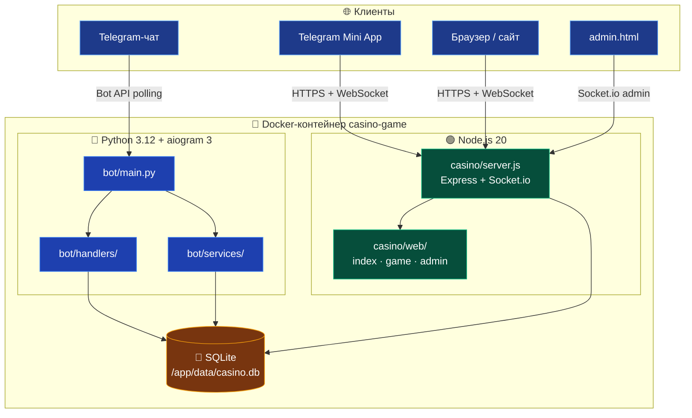
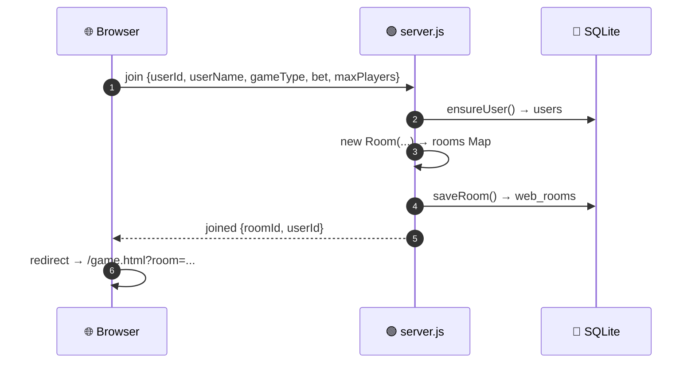
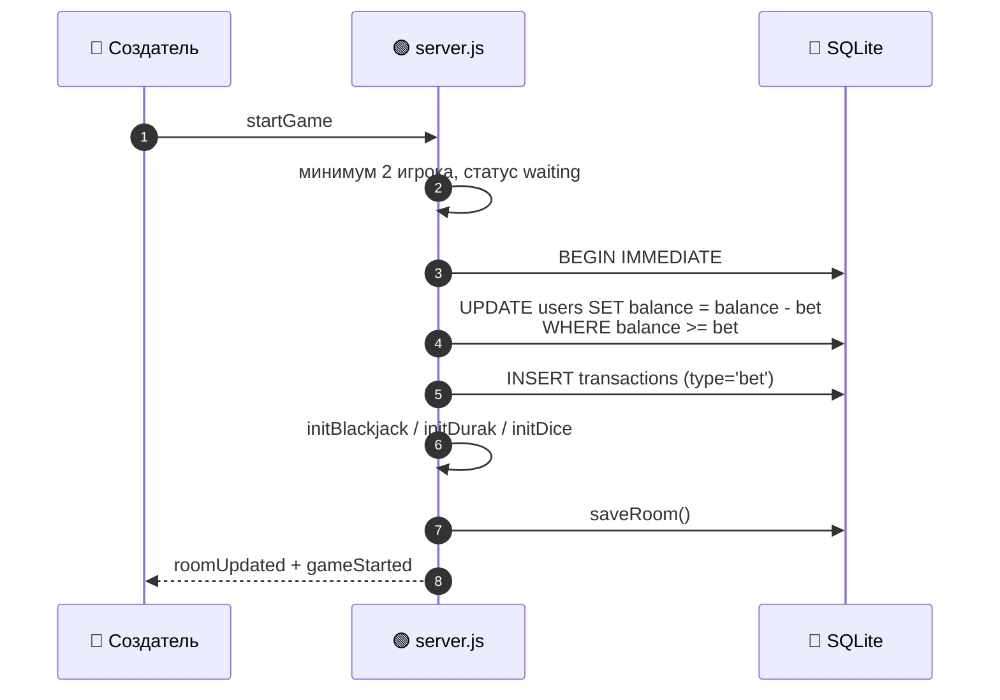
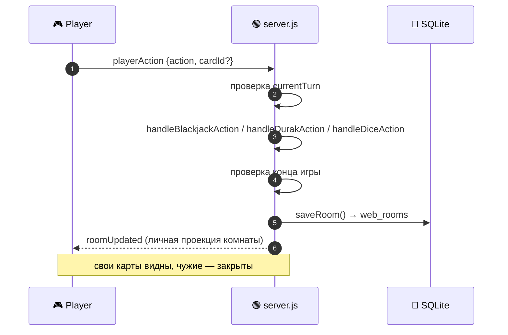
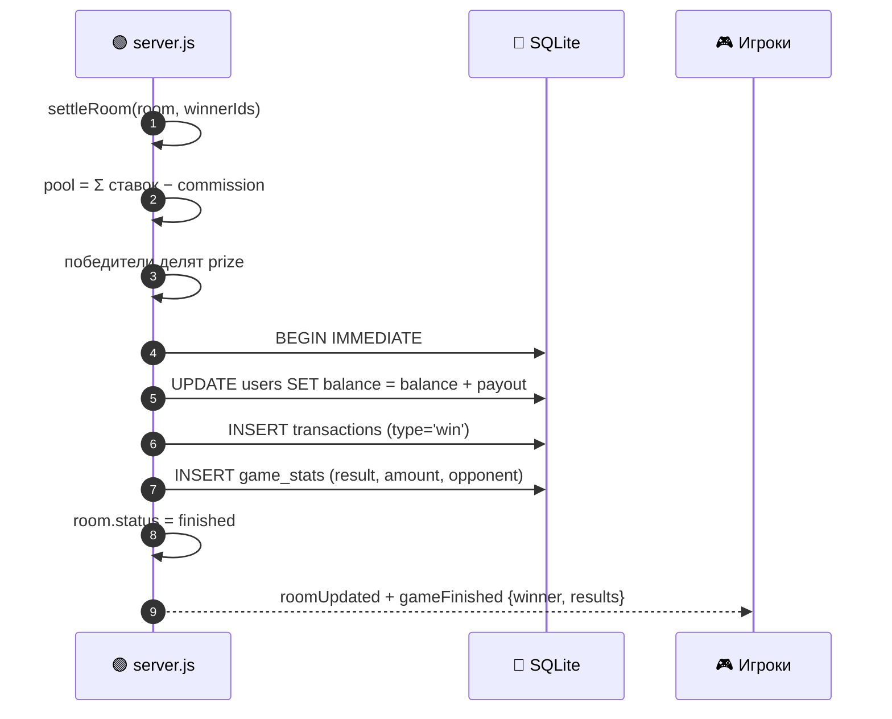

<a id="top"></a>
<div align="center">


<a href="README.md">
  
</a>

<br/>

<a href="README.md"></a>
<a href="ARCHITECTURE.md"></a>
<a href="DEPLOY.md"></a>
<a href="API.md"></a>

</div>

---

## 📊 Общая схема



Оба процесса запускаются одним скриптом `start.sh` внутри одного Docker-контейнера.

---

## 🧱 Компоненты

### 1. Telegram-бот (`bot/main.py`, `bot/handlers/`, `bot/services/`)

- `bot/main.py` — создаёт `Bot`, `Dispatcher`, подключает роутеры из `bot/handlers/`.
- `bot/handlers/` — команды, кнопки, FSM-сценарии, админка бота.
- `bot/services/rooms.py` — комнаты и игровой цикл Telegram-игр.
- `bot/services/banners.py` — отложенные рассылки.
- `bot/services/games.py` — справочник нативных игр Telegram.
- `bot/database.py` — единственный слой доступа к SQLite со стороны Python.
- `configs/config.py` — настройки из `.env` (подключается через `PYTHONPATH`).

### 2. Веб-сервер (`casino/server.js`)

- Express отдаёт `casino/web/` и HTTP API.
- Socket.io обслуживает мультиплеер в реальном времени.
- В памяти держит `Map<roomId, Room>`; каждый снимок комнаты сохраняется в `web_rooms`.
- При старте восстанавливает комнаты из `web_rooms`.
- Списывает и начисляет баланс через те же таблицы `users`, `transactions`, `game_stats`.

### 3. Фронтенд (`casino/web/`)

| Файл | Назначение |
|------|------------|
| `index.html` + `app.js` | главная: создание/поиск комнат, имя, ставка, число игроков |
| `game.html` + `game.js` | игровая комната: карты, кубики, действия, результаты |
| `admin.html` + `admin.js` | вход по паролю, статистика, комнаты, балансы, рассылка, транзакции |
| `style.css` | glassmorphism, анимации, адаптивная вёрстка |

### 4. SQLite

Одна база для обоих процессов:

```text
users            — id, username, first_name, balance, points, last_daily, referrer_id
transactions     — ставки, выигрыши, возвраты, пополнения, выводы
game_stats       — история игр (game_key, bet, result, amount, opponent)
web_rooms        — JSON-снимки активных веб-комнат
promocodes       — промокоды
promo_uses       — использования промокодов
deposits         — заявки на пополнение
withdrawals      — заявки на вывод
banners          — баннеры и авто-рассылки
banner_sends     — кому уже отправлен баннер
settings         — настройки, изменяемые админом
referrals        — реферальные связи
```

SQLite работает в режиме **WAL** (`PRAGMA journal_mode=WAL`), включён `busyTimeout`, поэтому бот и веб-сервер могут писать одновременно.

---

## 🔄 Потоки данных

### Создание комнаты



### Старт игры и списание ставок



### Ход игрока



### Завершение и выплата



### Перезапуск сервера

```text
boot()
  ├─ initDb()        — таблицы и миграции
  ├─ loadRooms()     — восстановление web_rooms
  └─ server.listen() — HTTP + Socket.io
```

Если игра шла во время перезапуска и ставки уже были списаны, состояние комнаты сохраняется. Игроки могут переподключиться по ссылке `/game.html?room=...` и продолжить. Если все отключились более чем на 10 минут — сервер возвращает ставки.

---

## 🎮 Игровые правила в веб-версии

### Блэкджек

- Каждому игроку раздаётся 2 карты из колоды 36 карт.
- Туз = 11, но при переборе становится 1; J/Q/K = 10.
- Игрок может `hit` (взять карту) или `stand` (остановиться).
- При 21 или переборе ход автоматически завершается.
- Когда все остановились/перебрали: побеждает лучшая сумма ≤ 21.
- Несколько игроков с одинаковой лучшей суммой делят банк (ничья).

### Дурак

- Колода 36 карт, козырь — нижняя карта колоды.
- У каждого по 6 карт.
- Атакующий кладёт карту; защищающийся бьёт старшей картой той же масти или козырем.
- Атакующий может подкидывать карты того же достоинства.
- «Бито» — защищающийся отбился, карты уходят в сброс, оба добирают до 6.
- «Взять» — защищающийся забирает карты, атакующий добирает до 6.
- Проигрывает тот, у кого остались карты, когда колода закончилась.

### Кости

- Каждый игрок бросает кубик 1–6.
- Побеждает наибольшее значение.
- При равенстве победители делят банк (ничья).

### Таймауты и авто-ход

| Игра | Поведение по таймауту |
|------|------------------------|
| 🃏 Блэкджек | авто-`stand` |
| ♠️ Дурак | защищающийся берёт карты, атакующий завершает кон |
| 🎲 Кости | кубик бросается автоматически |

- `MOVE_TIMEOUT` секунд на ход (по умолчанию 30).
- Если игрок отключился, его ход всё равно произойдёт по таймауту.

---

## 🔐 Безопасность

| Механизм | Реализация |
|----------|------------|
| Пароль админки | `ADMIN_PASSWORD`, fallback `admin123` с предупреждением |
| Rate limit | вход в админку — 5 попыток/минуту; действия — 60/10 секунд |
| Валидация | ставки 1..1 000 000, 2–4 игрока, только 3 типа игр |
| Имена | обрезаются до 24 символов, удаляются управляющие символы и HTML-скобки |
| Ставки | списываются атомарно с проверкой `balance >= bet` |
| Скрытые карты | сервер отправляет каждому игроку только его карты |
| CSP | разрешены inline-скрипты и Telegram WebApp, запрещены объекты |
| Docker | непривилегированный пользователь `bot` |
| Секреты | `.env` в `.dockerignore` |

---

## 🧪 Тестирование

- `tests/run_tests.py` — 109 тестов Python-логики (база, экономика, комнаты, ставки, ничьи, бот, рассылки).
- Веб-логика проверяется через два браузера/вкладки и `/health`.
- Для проверки API удобно использовать:

```bash
curl http://localhost:3000/health
curl http://localhost:3000/api/rooms
curl http://localhost:3000/api/stats
curl http://localhost:3000/api/user/123456789
```

---

<div align="center">

[📖 README](README.md) · [📦 DEPLOY](DEPLOY.md) · [🔗 API](API.md)

<a href="#top">⬆ Наверх</a>

</div>
