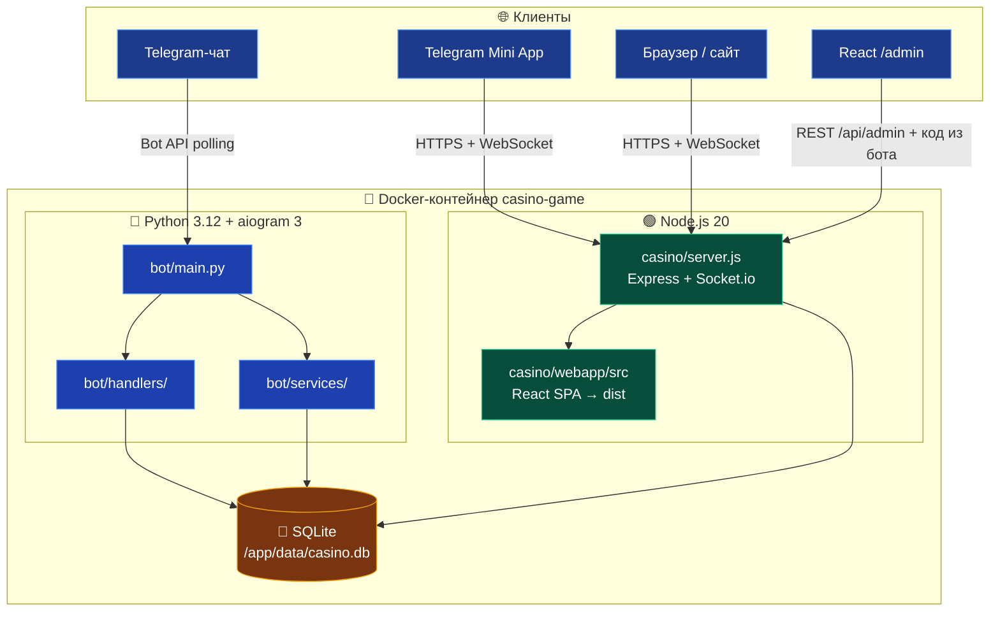
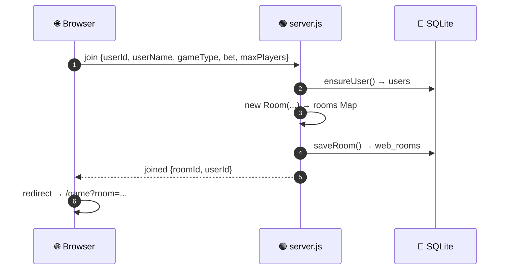
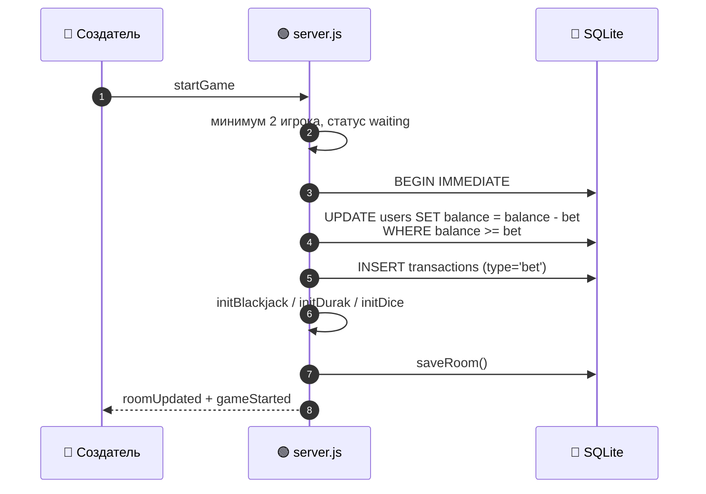
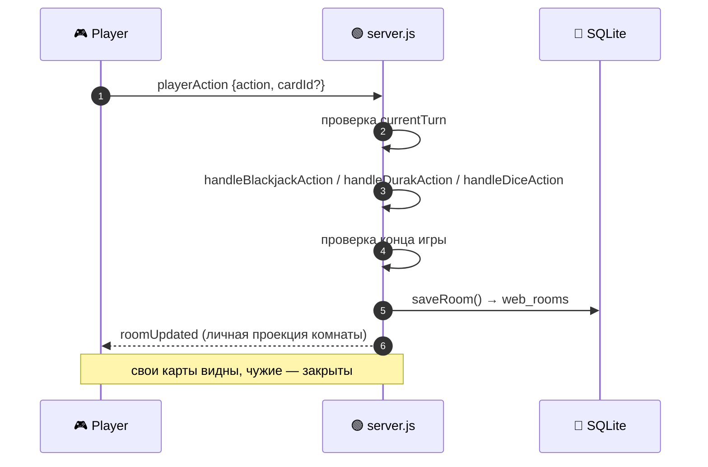
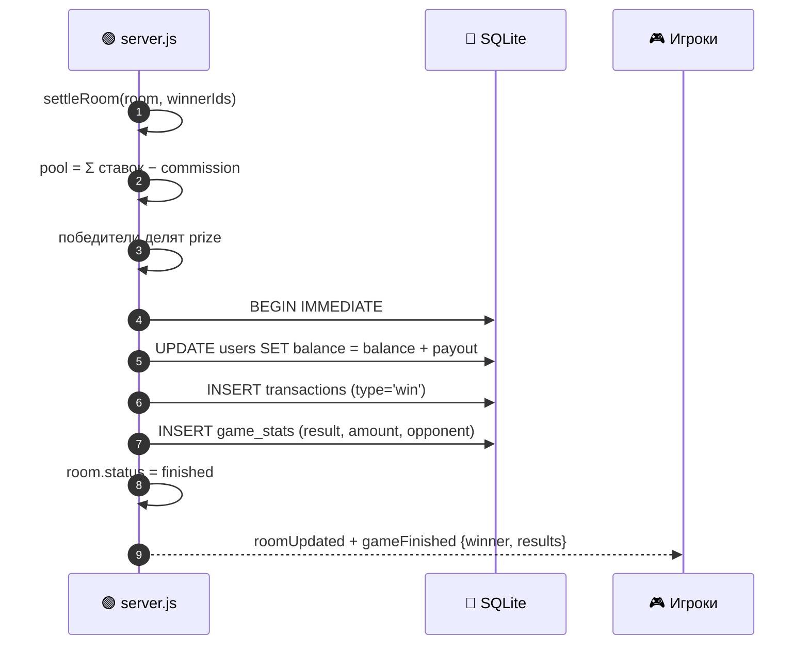
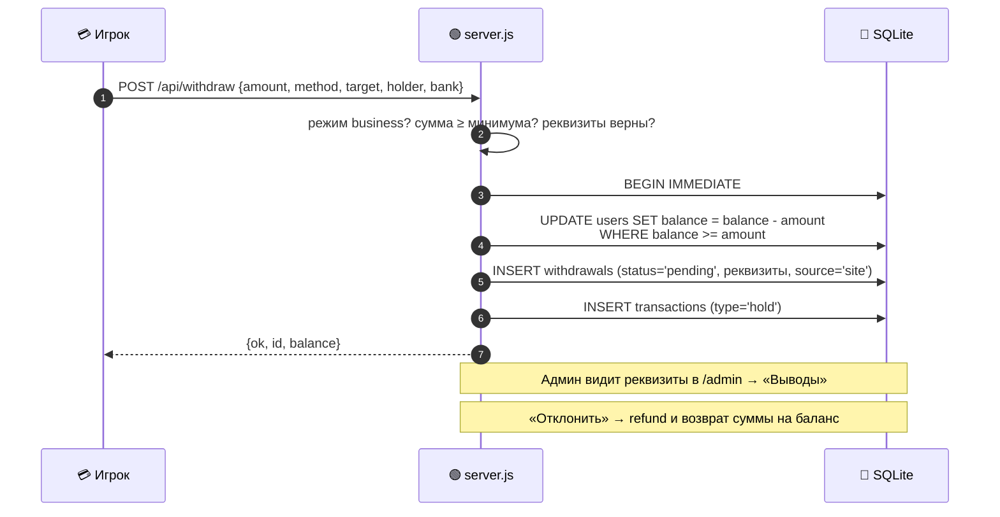

<a id="top"></a>
<div align="center">


<a href="README.md">
  
</a>

<br/>

<a href="README.md"></a>
<a href="ARCHITECTURE.md"></a>
<a href="DEPLOY.md"></a>
<a href="API.md"></a>
<a href="BACKEND_TUTORIAL.md"></a>

</div>

---

## 📊 Общая схема



Оба процесса живут в одном Docker-контейнере, и запускаются одной командой:
`python bot/main.py` (в контейнере — через `start.sh`). Бот сам стартует
Node.js-сайт, ждёт `/health`, перезапускает его при падении и гасит при выходе.
Отключить автозапуск сайта можно через `WEB_AUTOSTART=0`.

### Боты-соперники

В веб-комнате создатель может добавить ботов («🤖 Добавить бота»), чтобы играть
одному. Боты живут только в памяти комнаты, не пишутся в БД и не платят ставку,
поэтому на баланс реальных игроков не влияют.

---

## 🧱 Компоненты

### 1. Telegram-бот (`bot/main.py`, `bot/handlers/`, `bot/services/`)

- `bot/main.py` — создаёт `Bot`, `Dispatcher`, подключает роутеры из `bot/handlers/`.
- `bot/handlers/` — команды, кнопки, FSM-сценарии, админка бота.
- `bot/services/rooms.py` — комнаты и игровой цикл Telegram-игр.
- `bot/services/banners.py` — отложенные рассылки.
- `bot/services/games.py` — справочник нативных игр Telegram.
- `bot/database.py` — единственный слой доступа к SQLite со стороны Python.
- `configs/config.py` — настройки из `.env` (подключается через `PYTHONPATH`).

### 2. Веб-сервер (`casino/server.js`)

- Express отдаёт собранный React-фронтенд `casino/webapp/dist` и HTTP API.
- Socket.io обслуживает мультиплеер в реальном времени.
- В памяти держит `Map<roomId, Room>`; каждый снимок комнаты сохраняется в `web_rooms`.
- При старте восстанавливает комнаты из `web_rooms`.
- Списывает и начисляет баланс через те же таблицы `users`, `transactions`, `game_stats`.
- REST `/api/*` обслуживает вход по коду, кассу, выводы и админку; `/api/mode`
  отдаёт текущий режим «Бизнес/Развлечение».
- В `/api/rooms` попадают только комнаты с онлайн-игроками (`Room.isVisible()`).

### 3. Фронтенд (`casino/webapp/`)

React + Vite. Исходники в `src/`, сборка в `dist/` (её отдаёт Express).

| Файл | Назначение |
|------|------------|
| `pages/HomePage.jsx` | главная: вход по коду, создание/поиск комнат, ставка, число игроков |
| `pages/GamePage.jsx` | игровая комната: карты, кубики, действия, результаты; при выходе отправляет `leaveRoom` |
| `pages/DonatePage.jsx` | касса: пополнение, вывод на карту/счёт, история заявок |
| `pages/StatsPage.jsx` | топы и личная статистика |
| `pages/AdminPage.jsx` | вход по коду из бота, статистика, комнаты, балансы, донаты, выводы, режим, настройки |
| `components/Layout.jsx` | адаптивная навигация; в режиме `fun` скрывает «Кассу» |
| `context/AppContext.jsx` | сессия игрока, токен, режим и тосты |
| `styles.css` | glassmorphism, анимации, адаптивная вёрстка (мобильный таб-бар) |

Подробности серверной части — в [BACKEND.md](BACKEND.md), обучающий разбор — в
[BACKEND_TUTORIAL.md](BACKEND_TUTORIAL.md).

### 4. SQLite

Одна база для обоих процессов:

```text
users            — id, username, first_name, balance, points, last_daily, referrer_id
transactions     — ставки, выигрыши, возвраты, пополнения, выводы
game_stats       — история игр (game_key, bet, result, amount, opponent)
web_rooms        — JSON-снимки активных веб-комнат
promocodes       — промокоды
promo_uses       — использования промокодов
deposits         — заявки на пополнение (source: site | bot)
withdrawals      — заявки на вывод + реквизиты (payout_method, payout_target,
                   payout_name, payout_bank, source)
login_codes      — одноразовые коды входа (kind: player | admin)
web_sessions     — сессии сайта и админки
banners          — баннеры и авто-рассылки
banner_sends     — кому уже отправлен баннер
settings         — настройки админа, включая APP_MODE (business | fun)
referrals        — реферальные связи
```

SQLite работает в режиме **WAL** (`PRAGMA journal_mode=WAL`), включён `busyTimeout`, поэтому бот и веб-сервер могут писать одновременно.

---

## 🔄 Потоки данных

### Создание комнаты



### Старт игры и списание ставок



### Ход игрока



### Завершение и выплата



### Вывод на карту или счёт



### Перезапуск сервера

```text
boot()
  ├─ initDb()        — таблицы и миграции
  ├─ loadRooms()     — восстановление web_rooms
  └─ server.listen() — HTTP + Socket.io
```

Если игра шла во время перезапуска и ставки уже были списаны, состояние комнаты сохраняется. Игроки могут переподключиться по ссылке `/game?room=...` и продолжить. Если все отключились более чем на 10 минут — сервер возвращает ставки.

### Очистка комнат

- `Room.isVisible()` — в `/api/rooms` попадают только комнаты с онлайн-игроком.
- `leaveRoom` — явный выход удаляет игрока, пустая комната удаляется сразу.
- Раз в минуту фоновая задача убирает «осиротевшие» и старые комнаты,
  возвращает ставки в брошенных партиях и чистит записи в `web_rooms`.

---

## 🎛 Режим работы: «Бизнес» / «Развлечение»

Режим хранится в `settings` под ключом `APP_MODE` и читается из БД на каждом
запросе — переключение в `/admin` действует сразу, без перезапуска.

| Режим | Поведение |
|---|---|
| `business` | работают донаты, пополнения и выводы |
| `fun` | только игра ради веселья: денежные операции запрещены |

Ограничения действуют на сервере (`403` для `/api/donate` и `/api/withdraw`),
а UI и бот лишь скрывают лишние кнопки. Это важно: клиентские проверки легко
обойти, серверные — нет.

---

## 🎮 Игровые правила в веб-версии

### Блэкджек

- Каждому игроку раздаётся 2 карты из колоды 36 карт.
- Туз = 11, но при переборе становится 1; J/Q/K = 10.
- Игрок может `hit` (взять карту) или `stand` (остановиться).
- При 21 или переборе ход автоматически завершается.
- Когда все остановились/перебрали: побеждает лучшая сумма ≤ 21.
- Несколько игроков с одинаковой лучшей суммой делят банк (ничья).

### Дурак

- Колода 36 карт, козырь — нижняя карта колоды.
- У каждого по 6 карт.
- Атакующий кладёт карту; защищающийся бьёт старшей картой той же масти или козырем.
- Атакующий может подкидывать карты того же достоинства.
- «Бито» — защищающийся отбился, карты уходят в сброс, оба добирают до 6.
- «Взять» — защищающийся забирает карты, атакующий добирает до 6.
- Проигрывает тот, у кого остались карты, когда колода закончилась.

### Кости

- Каждый игрок бросает кубик 1–6.
- Побеждает наибольшее значение.
- При равенстве победители делят банк (ничья).

### Таймауты и авто-ход

| Игра | Поведение по таймауту |
|------|------------------------|
| 🃏 Блэкджек | авто-`stand` |
| ♠️ Дурак | защищающийся берёт карты, атакующий завершает кон |
| 🎲 Кости | кубик бросается автоматически |

- `MOVE_TIMEOUT` секунд на ход (по умолчанию 30).
- Если игрок отключился, его ход всё равно произойдёт по таймауту.

---

## 🔐 Безопасность

| Механизм | Реализация |
|----------|------------|
| Вход игрока | одноразовый код из бота (`login_codes`, TTL 15 минут) → токен на 30 дней |
| Вход админа | отдельный код `kind='admin'` только для `ADMIN_IDS`; сессия 12 часов |
| Пароль админки | только явно заданный `ADMIN_PASSWORD`; `admin123` не работает |
| Проверка админа | `ADMIN_PANEL_ENABLED` + срок сессии + `ADMIN_IDS` на каждом запросе |
| Rate limit | вход 12/мин, донаты и выводы 10/час, админ-вход 8/мин; socket — 60 действий/10 с |
| Валидация | ставки 1..1 000 000, 2–4 игрока, только 3 типа игр; реквизиты вывода проверяются |
| Имена | обрезаются до 24 символов, удаляются управляющие символы и HTML-скобки |
| Ставки | списываются атомарно с проверкой `balance >= bet` |
| Выводы | сумма замораживается (`hold`), при отказе возвращается (`refund`) |
| Режим `fun` | серверный `403` на донат/вывод, кнопки скрываются в UI и боте |
| Скрытые карты | сервер отправляет каждому игроку только его карты |
| CSP | разрешены inline-скрипты и Telegram WebApp, запрещены объекты |
| Docker | непривилегированный пользователь `bot` |
| Секреты | `.env` в `.dockerignore` |

---

## 🧪 Тестирование

- `tests/run_tests.py` — 117 проверок Python-логики (база, экономика, режим,
  реквизиты вывода, комнаты, ставки, ничьи, бот, рассылки).
- `tests/web_e2e.js` — 60 проверок: настоящий `casino/server.js`, три игры,
  боты, вход по коду, донаты, вывод, режим и очистка комнат.
- Для ручной проверки API удобно использовать:

```bash
curl http://localhost:3000/health
curl http://localhost:3000/api/rooms
curl http://localhost:3000/api/mode
curl http://localhost:3000/api/stats
curl http://localhost:3000/api/user/123456789
```

---

<div align="center">

[📖 README](README.md) · [📦 DEPLOY](DEPLOY.md) · [🔗 API](API.md) · [🎓 BACKEND_TUTORIAL](BACKEND_TUTORIAL.md)

<a href="#top">⬆ Наверх</a>

</div>
