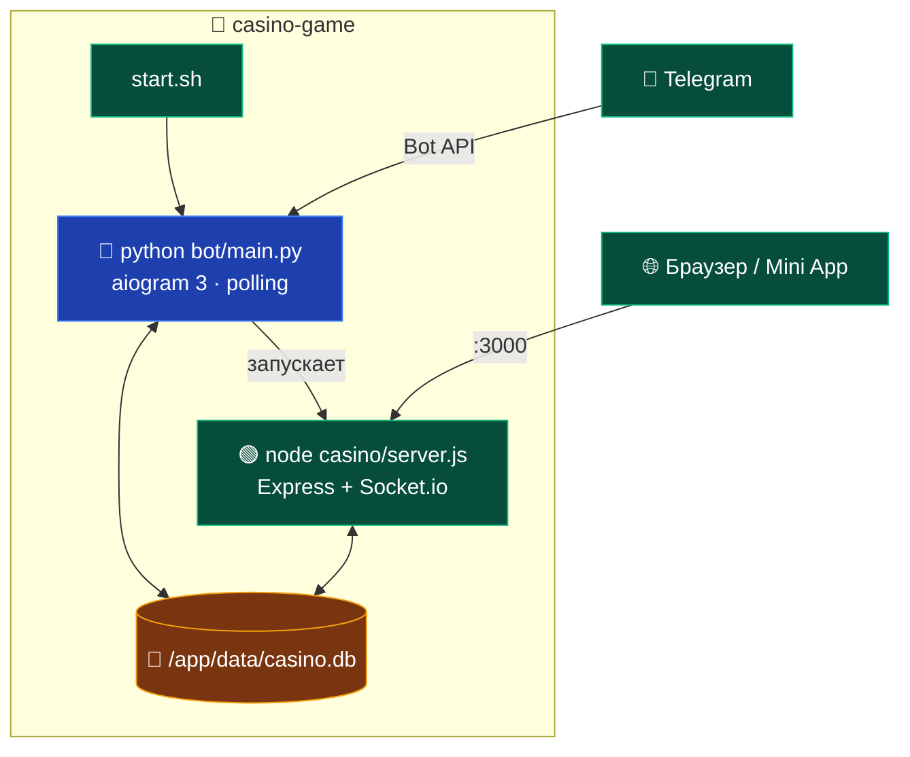

<a id="top"></a>
<div align="center">


<a href="README.md">
  
</a>

<br/>

<a href="README.md"></a>
<a href="ARCHITECTURE.md"></a>
<a href="DEPLOY.md"></a>
<a href="deploy/VPS.md"></a>
<a href="API.md"></a>
<a href="BACKEND.md"></a>

</div>

---

Один Docker-контейнер запускает **Telegram-бота**, **веб-сервер игры** и **SQLite**.  
Инструкция рассчитана на сервер с Linux, но команды работают и на Windows/macOS с Docker Desktop.

> 🌍 **Хостинг на своём VPS с HTTPS:** используйте production-стек
> `docker-compose.vps.yml` + Caddy и пошаговую инструкцию
> **[deploy/VPS.md](deploy/VPS.md)**. Ниже — базовый запуск и детали.

---

## ✅ Требования

| | Требование |
|---|------------|
| 🐳 | Docker 20.10+ |
| 📦 | Docker Compose v2 (`docker compose`, не `docker-compose`) |
| 🧠 | 1 ГБ RAM и 1 ГБ свободного места |
| 🤖 | Токен Telegram-бота от [@BotFather](https://t.me/BotFather) |
| 🔒 | Для Mini App — публичный **HTTPS**-домен |

---

## 🚀 Быстрый старт

```bash
git clone https://github.com/JamikKhidirov/CasinoGame.git
cd CasinoGame
cp .env.example .env
nano .env          # BOT_TOKEN, ADMIN_IDS, ADMIN_PASSWORD
docker compose up -d --build
```

Проверить, что всё поднялось:

```bash
docker compose ps
docker compose logs -f
curl http://localhost:3000/health
```

Ожидаемый ответ health check:

```json
{
  "status": "ok",
  "timestamp": "2026-11-09T12:00:00.000Z",
  "rooms": 0,
  "players": 0,
  "db": "ok"
}
```

---

## 🧩 Что запускается внутри контейнера



`start.sh` запускает единый процесс бота, который сам поднимает сайт:

```text
/app/start.sh
└── python /app/bot/main.py      # Telegram-бот (aiogram 3, polling)
    └── node /app/casino/server.js   # Express + Socket.io + React (webapp/dist) + SQLite
```

Если бот не может авторизоваться в Telegram (неверный `BOT_TOKEN`), сайт всё
равно остаётся доступным — в логах будет понятное сообщение об ошибке.

Если один процесс падает, контейнер останавливается и Docker перезапускает его (`restart: unless-stopped`).

| Процесс | Что делает |
|---------|------------|
| `python bot/main.py` | обрабатывает команды Telegram, игры в чате, админку бота; запускает и перезапускает сайт |
| `node casino/server.js` | отдаёт сайт (`/`, `/game`, `/admin`), Socket.io, HTTP API, хранит комнаты |
| SQLite | общая база `/app/data/casino.db` для обоих процессов |

> Внутри контейнера `PYTHONPATH=/app/configs:/app/bot` — так `config` из `configs/` и модули бота из `bot/` доступны без изменения импортов. Для локального запуска это не нужно: `bot/main.py` добавляет пути сам.

---

## ⚙️ Переменные окружения

Создайте `.env` из `.env.example`. Минимально нужно:

```env
BOT_TOKEN=123456789:REPLACE_WITH_YOUR_BOT_TOKEN
ADMIN_IDS=123456789
ADMIN_PASSWORD=change_me
```

<details open>
<summary>Полная таблица переменных</summary>

| Переменная | По умолчанию | Описание |
|------------|--------------|----------|
| `BOT_TOKEN` | — | **обязательно**: токен Telegram-бота |
| `ADMIN_IDS` | — | Telegram ID админов через запятую (главный вход в `/admin`) |
| `ADMIN_PASSWORD` | — | запасной пароль `/admin`; без него доступ только по коду из бота |
| `ADMIN_PASSWORD_LOGIN` | `1` | `0` — полностью отключить вход по паролю |
| `ADMIN_PANEL_ENABLED` | `1` | `0` — закрыть веб-админку для всех |
| `WEB_URL` | `http://localhost:3000` | публичный адрес сайта для кнопок бота |
| `DOMAIN` | — | домен для `docker-compose.vps.yml`; Caddy выпустит HTTPS. Можно `IP-через-дефисы.sslip.io` |
| `PORT` | `3000` | порт веб-сервера внутри контейнера |
| `CORS_ORIGIN` | `*` | разрешённые origin для Socket.io |
| `DB_PATH` | `/app/data/casino.db` | путь к SQLite (в Docker задан в Dockerfile) |
| `NODE_ENV` | `production` | режим Node.js |
| `START_BALANCE` | `1000` | стартовый баланс нового игрока 💰 |
| `START_POINTS` | `2000` | стартовые очки ⭐ |
| `MIN_BET` / `MAX_BET` | `1` / `1000000` | лимиты ставок 💰 |
| `COMMISSION_PERCENT` | `0` | комиссия казино, % от банка |
| `MOVE_TIMEOUT` | `30` | секунд до автоматического хода |
| `JOIN_TIMEOUT` | `15` | ожидание соперника в комнатах бота |
| `DICE_ROLL_DELAY` | `3` | задержка анимации кубика в боте |
| `RESULT_MSG_TTL` | `15` | удаление результата игры в боте |
| `BANNER_CHECK_INTERVAL` | `30` | период проверки авто-рассылок |
| `WITHDRAW_MIN` | `1000` | минимальная сумма вывода |
| `WITHDRAW_NOTE` | «Выплата на карту или счёт…» | подсказка игроку при выводе |
| `APP_MODE` | `business` | `business` — донаты/пополнения/выводы включены; `fun` — только игра |
| `DONATE_CARD_TYPE` / `DONATE_CARD_NUMBER` / `DONATE_CARD_NAME` | — | реквизиты для донатов |
| `POINTS_MIN_BET` / `POINTS_MAX_BET` | `10` / `100000` | лимиты ставок в очках ⭐ |
| `POINTS_BUY_RATE` | `150` | курс 100 💰 → ⭐ |
| `POINTS_SELL_RATE` | `60` | курс 100 ⭐ → 💰 |

</details>

> Настройки экономики можно менять и из Telegram-админки бота (`/admin → Настройки`).  
> Веб-сервер читает `START_BALANCE`, `MIN_BET`, `MAX_BET`, `COMMISSION_PERCENT`, `MOVE_TIMEOUT` из `.env`.

### 🎛 Режим работы и касса

`APP_MODE` задаёт, работают ли деньги:

- `business` — пополнения, донаты и выводы доступны;
- `fun` — только игра ради веселья, денежные операции отключены на сервере.

Текущий режим переключается в веб-админке: **`/admin` → Настройки → Режим работы**.
Значение хранится в таблице `settings` и имеет приоритет над `.env`, поэтому
после первого переключения правки `APP_MODE` в `.env` не нужны — меняйте режим
из панели, он применяется сразу и к сайту, и к боту без перезапуска.

Реквизиты пополнения и лимит вывода тоже редактируются в `/admin → Настройки`
и сохраняются в SQLite (`DONATE_CARD_*`, `WITHDRAW_MIN`, `WITHDRAW_NOTE`).

---

## 🐳 Команды Docker

| Команда | Что делает |
|---------|------------|
| `docker compose up -d --build` | собрать и запустить весь стек |
| `docker compose ps` | статус контейнера |
| `docker compose logs -f` | логи бота и веб-сервера |
| `docker compose restart` | перезапустить |
| `docker compose down` | остановить, данные сохранить |
| `docker compose down -v` | остановить и **удалить базу** |
| `docker compose build --no-cache` | полная пересборка образа |

Обновление после `git pull`:

```bash
git pull
docker compose up -d --build
```

---

## 🚀 Деплой на свой VPS (HTTPS + Caddy)

Для постоянного хостинга используйте production-стек `docker-compose.vps.yml`:
приложение не публикует порт `3000`, а Caddy слушает `80/443`, сам получает
сертификат Let's Encrypt и проксирует HTTP API и Socket.io (WebSocket).

```bash
git clone https://github.com/JamikKhidirov/CasinoGame.git
cd CasinoGame
sudo bash deploy/install.sh
```

Скрипт установит Docker, создаст `.env`, спросит `BOT_TOKEN`, `ADMIN_IDS`,
пароль и домен, откроет порты в firewall и запустит стек. Backup:

```bash
sudo bash deploy/backup.sh
```

| Файл | Назначение |
|------|------------|
| `docker-compose.vps.yml` | приложение + Caddy, тома для базы и сертификатов |
| `deploy/Caddyfile` | reverse proxy, HTTPS, WebSocket, gzip/zstd |
| `deploy/install.sh` | установка Docker и первичная настройка |
| `deploy/backup.sh` | целостный backup SQLite + ротация копий |
| `deploy/VPS.md` | подробная пошаговая инструкция |

📚 DNS, `sslip.io` без домена, firewall, Telegram Mini App, обновление,
восстановление базы и troubleshooting: **[deploy/VPS.md](deploy/VPS.md)**.

---

## ☁️ Деплой в Amvera Cloud

В корне лежит готовый `amvera.yml`. Amvera собирает проект по `Dockerfile`; **`docker-compose.yml` там не поддерживается**.

```yaml
build:
  dockerfile: Dockerfile

run:
  containerPort: 3000
  persistenceMount: /app/data
```

1. Загрузите репозиторий в Amvera (GitHub или Amvera Git).
2. В разделе **Переменные** задайте `BOT_TOKEN`, `ADMIN_IDS`, `ADMIN_PASSWORD`, остальные — по желанию.
3. `DB_PATH=/app/data/casino.db` уже задан в `Dockerfile`, а `persistenceMount: /app/data` подключает постоянное хранилище — база переживает пересборку.
4. Порт приложения — `3000`, тип — веб-приложение (HTTP).

> Для Telegram Mini App нужен HTTPS-домен. Amvera выдаёт его автоматически; останется указать URL в `@BotFather`.

---

## 💾 Backup и восстановление

База лежит в именованном томе `casino_game_data`.

### Скрипт (рекомендуется)

```bash
cd /opt/casino    # папка с репозиторием
sudo bash deploy/backup.sh

# свой каталог и срок хранения
sudo BACKUP_DIR=/mnt/backups KEEP=30 bash deploy/backup.sh
```

Скрипт делает **целостную** копию через SQLite backup API на работающем
контейнере, сжимает её в `backups/casino-YYYYMMDD-HHMMSS.db.gz` и удаляет
копии старше `KEEP` дней (по умолчанию 14).

Ежедневный backup через cron:

```cron
0 3 * * * /bin/bash /opt/casino/deploy/backup.sh >> /var/log/casino-backup.log 2>&1
```

Полная инструкция по восстановлению: [deploy/VPS.md#backup-и-восстановление](deploy/VPS.md#backup-и-восстановление).

### Вручную через docker

```bash
docker compose exec casino sh -c \
  "sqlite3 /app/data/casino.db '.backup /app/data/backup.db'" \
  && docker cp casino-game:/app/data/backup.db ./casino-backup.db
```

Если `sqlite3` нет в контейнере, проще остановить контейнер и скопировать файл:

```bash
docker compose stop
docker cp casino-game:/app/data/casino.db ./casino-backup.db
docker compose start
```

### Восстановить

```bash
docker compose stop
docker cp ./casino-backup.db casino-game:/app/data/casino.db
docker compose start
```

> SQLite работает в режиме WAL, поэтому при копировании на работающем контейнере могут появиться файлы `casino.db-wal` и `casino.db-shm`. Для гарантированно целостного backup останавливайте контейнер.

---

## 📱 Telegram Mini App и HTTPS

Telegram открывает Mini App только по **HTTPS** на публичном домене. `localhost` подойдёт для разработки, но не для реального Telegram.

В production-стеке `docker-compose.vps.yml` HTTPS настраивает **Caddy**
автоматически — отдельный nginx не нужен. Достаточно указать `DOMAIN` в `.env`
и выполнить `sudo bash deploy/install.sh`. Подробности:
[deploy/VPS.md](deploy/VPS.md).

Если вы используете обычный `docker-compose.yml` за своим nginx, минимальный конфиг:

```nginx
server {
    listen 80;
    server_name casino.example.com;
    return 301 https://$host$request_uri;
}

server {
    listen 443 ssl;
    server_name casino.example.com;

    ssl_certificate     /etc/letsencrypt/live/casino.example.com/fullchain.pem;
    ssl_certificate_key /etc/letsencrypt/live/casino.example.com/privkey.pem;

    location / {
        proxy_pass http://127.0.0.1:3000;
        proxy_http_version 1.1;
        proxy_set_header Upgrade $http_upgrade;
        proxy_set_header Connection "upgrade";
        proxy_set_header Host $host;
        proxy_set_header X-Forwarded-For $proxy_add_x_forwarded_for;
    }
}
```

Затем в `@BotFather`:

1. `/setmenubutton` → URL `https://casino.example.com/`
2. При необходимости `/setdomain` → `casino.example.com`

Пользователь Telegram Mini App использует свой настоящий Telegram ID и тот же баланс, что и в боте.

---

## 🐛 Troubleshooting

### Контейнер перезапускается

```bash
docker compose logs -f
```

Частые причины:

- не задан или неверный `BOT_TOKEN`;
- занят порт 3000;
- нет прав на запись в `/app/data`;
- не хватает памяти при сборке `sqlite3`.

### Порт 3000 занят

Измените `docker-compose.yml`:

```yaml
ports:
  - "8080:3000"
```

Сайт будет доступен на `http://localhost:8080`.

### Не пускает в админку

- Основной вход — одноразовый код: в боте `/admin` → «🌐 Войти в веб-админку (код)».
- Убедитесь, что ваш Telegram ID есть в `ADMIN_IDS`, а `ADMIN_PANEL_ENABLED` не равен `0`.
- Пароль работает только если `ADMIN_PASSWORD` задан явно и `ADMIN_PASSWORD_LOGIN=1`.
- После изменения `.env` выполните `docker compose up -d` (контейнер пересоздастся).

### `/game` или `/admin` возвращают 503

Не собрался React-фронтенд. Пересоберите образ или соберите вручную:

```bash
docker compose build --no-cache
docker compose up -d

# локально без Docker
cd casino/webapp && npm install && npm run build
```

### Не работают пополнение и вывод

Скорее всего включён режим «Развлечение». Проверьте:

- в админке `/admin → Настройки → Режим работы` должно быть «Бизнес»;
- либо в базе: `SELECT value FROM settings WHERE key='APP_MODE'` — `business`;
- `APP_MODE=fun` в `.env` действует только до первого сохранения режима из панели.

В режиме `fun` сервер намеренно отвечает `403` на `/api/donate` и `/api/withdraw`,
а бот скрывает денежные кнопки.

### Комнаты висят в списке

- Пустые комнаты не показываются в `/api/rooms` и удаляются фоновой очисткой
  в течение минуты.
- Если видите старую комнату после обновления кода — перезапустите контейнер:
  `docker compose restart`.
- Убедитесь, что браузер не держит вкладку игры открытой: при уходе со страницы
  клиент отправляет `leaveRoom`.

### Ошибка сборки `node-sqlite3`

В Dockerfile уже установлены `build-essential` и `python3` для компиляции нативного модуля. Если ошибка осталась, проверьте интернет и место на диске, затем:

```bash
docker compose build --no-cache
```

### Данные не сохраняются

- Не используйте `docker compose down -v` — флаг `-v` удаляет том.
- Убедитесь, что в `docker-compose.yml` есть `casino_data:/app/data`.
- Проверьте, что контейнер запущен не с другим `DB_PATH`.

### Бот не отвечает

- Проверьте токен в `.env`.
- Убедитесь, что у бота выключен privacy mode: `@BotFather → /setprivacy → Disable` (если нужны сообщения в группах).
- Посмотрите логи: `docker compose logs -f`.

---

## 🛡 Безопасность

| | Мера |
|---|------|
| 🔒 | `.env` исключён из Docker-образа через `.dockerignore` |
| 👤 | Контейнер работает от непривилегированного пользователя `bot` (uid 1000) |
| 🔑 | Вход в админку — одноразовый код из бота для `ADMIN_IDS`; пароль только если задан явно |
| 💸 | Вывод замораживает сумму до подтверждения админом |
| 🎛 | В режиме `fun` денежные операции запрещены на сервере (`403`) |
| 🚦 | Встроенный rate limit на вход, донаты, выводы и игровые действия |
| 🧱 | CSP настроен под Telegram WebApp и inline-скрипты |
| 🙈 | Не публикуйте `.env` и backup-файлы базы |

---

<div align="center">

[📖 README](README.md) · [🏗 ARCHITECTURE](ARCHITECTURE.md) · [🎓 BACKEND_TUTORIAL](BACKEND_TUTORIAL.md) · [🔗 API](API.md)

<a href="#top">⬆ Наверх</a>

</div>
