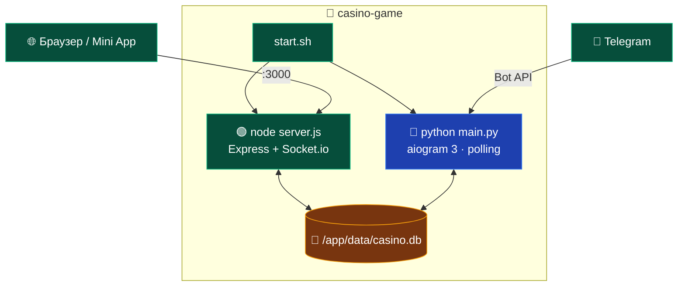

<a id="top"></a>
<div align="center">


<a href="README.md">
  
</a>

<br/>

<a href="README.md"></a>
<a href="ARCHITECTURE.md"></a>
<a href="DEPLOY.md"></a>
<a href="API.md"></a>

</div>

---

Один Docker-контейнер запускает **Telegram-бота**, **веб-сервер игры** и **SQLite**.  
Инструкция рассчитана на сервер с Linux, но команды работают и на Windows/macOS с Docker Desktop.

---

## ✅ Требования

| | Требование |
|---|------------|
| 🐳 | Docker 20.10+ |
| 📦 | Docker Compose v2 (`docker compose`, не `docker-compose`) |
| 🧠 | 1 ГБ RAM и 1 ГБ свободного места |
| 🤖 | Токен Telegram-бота от [@BotFather](https://t.me/BotFather) |
| 🔒 | Для Mini App — публичный **HTTPS**-домен |

---

## 🚀 Быстрый старт

```bash
git clone https://github.com/JamikKhidirov/CasinoGame.git
cd CasinoGame
cp .env.example .env
nano .env          # BOT_TOKEN, ADMIN_IDS, ADMIN_PASSWORD
docker compose up -d --build
```

Проверить, что всё поднялось:

```bash
docker compose ps
docker compose logs -f
curl http://localhost:3000/health
```

Ожидаемый ответ health check:

```json
{
  "status": "ok",
  "timestamp": "2026-11-09T12:00:00.000Z",
  "rooms": 0,
  "players": 0,
  "db": "ok"
}
```

---

## 🧩 Что запускается внутри контейнера



`start.sh` запускает два процесса одновременно:

```text
/app/start.sh
├── node server.js     # Express + Socket.io + web/ + SQLite
└── python main.py     # Telegram-бот (aiogram 3, polling)
```

Если один процесс падает, контейнер останавливается и Docker перезапускает его (`restart: unless-stopped`).

| Процесс | Что делает |
|---------|------------|
| `node server.js` | отдаёт сайт, `/game.html`, `/admin.html`, Socket.io, HTTP API, хранит комнаты |
| `python main.py` | обрабатывает команды Telegram, игры в чате, админку бота |
| SQLite | общая база `/app/data/casino.db` для обоих процессов |

---

## ⚙️ Переменные окружения

Создайте `.env` из `.env.example`. Минимально нужно:

```env
BOT_TOKEN=123456789:REPLACE_WITH_YOUR_BOT_TOKEN
ADMIN_IDS=123456789
ADMIN_PASSWORD=change_me
```

<details open>
<summary>Полная таблица переменных</summary>

| Переменная | По умолчанию | Описание |
|------------|--------------|----------|
| `BOT_TOKEN` | — | **обязательно**: токен Telegram-бота |
| `ADMIN_IDS` | — | Telegram ID админов через запятую |
| `ADMIN_PASSWORD` | `admin123` | пароль `/admin.html`; если не задан — используется `admin123` с предупреждением в логах |
| `PORT` | `3000` | порт веб-сервера внутри контейнера |
| `CORS_ORIGIN` | `*` | разрешённые origin для Socket.io |
| `DB_PATH` | `/app/data/casino.db` | путь к SQLite (в Docker задан в Dockerfile) |
| `NODE_ENV` | `production` | режим Node.js |
| `START_BALANCE` | `1000` | стартовый баланс нового игрока 💰 |
| `START_POINTS` | `2000` | стартовые очки ⭐ |
| `MIN_BET` / `MAX_BET` | `1` / `1000000` | лимиты ставок 💰 |
| `COMMISSION_PERCENT` | `0` | комиссия казино, % от банка |
| `MOVE_TIMEOUT` | `30` | секунд до автоматического хода |
| `JOIN_TIMEOUT` | `15` | ожидание соперника в комнатах бота |
| `DICE_ROLL_DELAY` | `3` | задержка анимации кубика в боте |
| `RESULT_MSG_TTL` | `15` | удаление результата игры в боте |
| `BANNER_CHECK_INTERVAL` | `30` | период проверки авто-рассылок |
| `WITHDRAW_MIN` | `1000` | минимальная сумма вывода |
| `WITHDRAW_NOTE` | — | текст способа выплаты |
| `DONATE_CARD_TYPE` / `DONATE_CARD_NUMBER` / `DONATE_CARD_NAME` | — | реквизиты для донатов |
| `POINTS_MIN_BET` / `POINTS_MAX_BET` | `10` / `100000` | лимиты ставок в очках ⭐ |
| `POINTS_BUY_RATE` | `150` | курс 100 💰 → ⭐ |
| `POINTS_SELL_RATE` | `60` | курс 100 ⭐ → 💰 |

</details>

> Настройки экономики можно менять и из Telegram-админки бота (`/admin → Настройки`).  
> Веб-сервер читает `START_BALANCE`, `MIN_BET`, `MAX_BET`, `COMMISSION_PERCENT`, `MOVE_TIMEOUT` из `.env`.

---

## 🐳 Команды Docker

| Команда | Что делает |
|---------|------------|
| `docker compose up -d --build` | собрать и запустить весь стек |
| `docker compose ps` | статус контейнера |
| `docker compose logs -f` | логи бота и веб-сервера |
| `docker compose restart` | перезапустить |
| `docker compose down` | остановить, данные сохранить |
| `docker compose down -v` | остановить и **удалить базу** |
| `docker compose build --no-cache` | полная пересборка образа |

Обновление после `git pull`:

```bash
git pull
docker compose up -d --build
```

---

## 💾 Backup и восстановление

База лежит в именованном томе `casino_game_data`.

### Сделать backup

```bash
docker compose exec casino sh -c \
  "sqlite3 /app/data/casino.db '.backup /app/data/backup.db'" \
  && docker cp casino-game:/app/data/backup.db ./casino-backup.db
```

Если `sqlite3` нет в контейнере, проще остановить контейнер и скопировать файл:

```bash
docker compose stop
docker cp casino-game:/app/data/casino.db ./casino-backup.db
docker compose start
```

### Восстановить

```bash
docker compose stop
docker cp ./casino-backup.db casino-game:/app/data/casino.db
docker compose start
```

> SQLite работает в режиме WAL, поэтому при копировании на работающем контейнере могут появиться файлы `casino.db-wal` и `casino.db-shm`. Для гарантированно целостного backup останавливайте контейнер.

---

## 📱 Telegram Mini App и HTTPS

Telegram открывает Mini App только по **HTTPS** на публичном домене. `localhost` подойдёт для разработки, но не для реального Telegram.

Вариант с Nginx + Let's Encrypt:

```nginx
server {
    listen 80;
    server_name casino.example.com;
    return 301 https://$host$request_uri;
}

server {
    listen 443 ssl;
    server_name casino.example.com;

    ssl_certificate     /etc/letsencrypt/live/casino.example.com/fullchain.pem;
    ssl_certificate_key /etc/letsencrypt/live/casino.example.com/privkey.pem;

    location / {
        proxy_pass http://127.0.0.1:3000;
        proxy_http_version 1.1;
        proxy_set_header Upgrade $http_upgrade;
        proxy_set_header Connection "upgrade";
        proxy_set_header Host $host;
        proxy_set_header X-Forwarded-For $proxy_add_x_forwarded_for;
    }
}
```

Затем в `@BotFather`:

1. `/setmenubutton` → URL `https://casino.example.com/`
2. При необходимости `/setdomain` → `casino.example.com`

Пользователь Telegram Mini App использует свой настоящий Telegram ID и тот же баланс, что и в боте.

---

## 🐛 Troubleshooting

### Контейнер перезапускается

```bash
docker compose logs -f
```

Частые причины:

- не задан или неверный `BOT_TOKEN`;
- занят порт 3000;
- нет прав на запись в `/app/data`;
- не хватает памяти при сборке `sqlite3`.

### Порт 3000 занят

Измените `docker-compose.yml`:

```yaml
ports:
  - "8080:3000"
```

Сайт будет доступен на `http://localhost:8080`.

### Не пускает в админку

- Проверьте `ADMIN_PASSWORD` в `.env`.
- Если переменная не задана, используется `admin123` — в логах будет предупреждение.
- После изменения `.env` выполните `docker compose up -d` (контейнер пересоздастся).

### `/game.html` или `/admin.html` возвращают 404

Значит запущен старый образ без этих файлов:

```bash
docker compose build --no-cache
docker compose up -d
```

### Ошибка сборки `node-sqlite3`

В Dockerfile уже установлены `build-essential` и `python3` для компиляции нативного модуля. Если ошибка осталась, проверьте интернет и место на диске, затем:

```bash
docker compose build --no-cache
```

### Данные не сохраняются

- Не используйте `docker compose down -v` — флаг `-v` удаляет том.
- Убедитесь, что в `docker-compose.yml` есть `casino_data:/app/data`.
- Проверьте, что контейнер запущен не с другим `DB_PATH`.

### Бот не отвечает

- Проверьте токен в `.env`.
- Убедитесь, что у бота выключен privacy mode: `@BotFather → /setprivacy → Disable` (если нужны сообщения в группах).
- Посмотрите логи: `docker compose logs -f`.

---

## 🛡 Безопасность

| | Мера |
|---|------|
| 🔒 | `.env` исключён из Docker-образа через `.dockerignore` |
| 👤 | Контейнер работает от непривилегированного пользователя `bot` (uid 1000) |
| 🔑 | Админ-панель защищена паролем `ADMIN_PASSWORD` |
| 🚦 | Встроенный rate limit на вход в админку и игровые действия |
| 🧱 | CSP настроен под Telegram WebApp и inline-скрипты |
| 🙈 | Не публикуйте `.env` и backup-файлы базы |

---

<div align="center">

[📖 README](README.md) · [🏗 ARCHITECTURE](ARCHITECTURE.md) · [🔗 API](API.md)

<a href="#top">⬆ Наверх</a>

</div>
