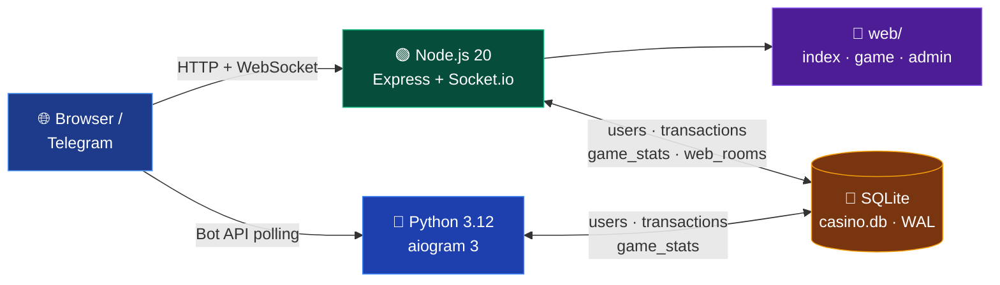

<a id="top"></a>
<div align="center">


<a href="https://github.com/JamikKhidirov/CasinoGame">
  
</a>

<br/>


<br/>


<br/><br/>

**Блэкджек, дурак и кости для 2–4 игроков в реальном времени.**  
Telegram-бот, веб-сайт, админ-панель и Telegram Mini App — в **одном Docker-контейнере**.  
Балансы, история игр и активные комнаты сохраняются в **SQLite**.

</div>

---

## 📚 Документация

<p align="center">
  <a href="README.md"></a>
  <a href="ARCHITECTURE.md"></a>
  <a href="DEPLOY.md"></a>
  <a href="API.md"></a>
</p>

| Документ | О чём |
|----------|-------|
| [🏗 ARCHITECTURE.md](ARCHITECTURE.md) | Компоненты, потоки данных, Mermaid-схемы, схема БД |
| [📦 DEPLOY.md](DEPLOY.md) | Развёртывание, `.env`, тома, backup, HTTPS, troubleshooting |
| [🔗 API.md](API.md) | HTTP API, Socket.io события, модели данных, примеры |
| [📖 README.md](README.md) | Этот файл — быстрый старт и обзор |

---

## ✨ Возможности

| | Возможность | Детали |
|---|-------------|--------|
| 🎮 | **3 игры** | Блэкджек 21, дурак, кости — 2–4 игрока |
| ⚡ | **Реальное время** | Socket.io: ходы приходят мгновенно всем |
| 🤖 | **Telegram-бот** | aiogram 3, игры в чате, ежедневный бонус, рефералы |
| 📱 | **Mini App** | Общий баланс и Telegram ID с ботом |
| 🛠 | **Админ-панель** | Веб + Telegram-админка, статистика, балансы, рассылки |
| 💾 | **SQLite** | WAL-режим, одна база для бота и веба |
| 🐳 | **Один контейнер** | Бот + веб + Socket.io + БД одной командой |
| 🎨 | **Glassmorphism** | Анимации, адаптив, тёмная тема |
| 🛡 | **Защита** | Rate limit, CSP, скрытые карты, непривилегированный пользователь |

---

## 🚀 Запуск одной командой

```bash
# 1. Клонировать репозиторий
git clone https://github.com/JamikKhidirov/CasinoGame.git
cd CasinoGame

# 2. Создать .env из шаблона
cp .env.example .env
```

Откройте `.env` и обязательно задайте:

```env
BOT_TOKEN=токен_от_@BotFather
ADMIN_IDS=ваш_telegram_id
ADMIN_PASSWORD=надёжный_пароль_для_админки
```

Затем:

```bash
# 3. Поднять ВЕСЬ стек: бот + веб + Socket.io + SQLite
docker compose up -d --build
```

> ⏳ Первая сборка занимает несколько минут: компилируется нативный модуль `sqlite3`.

Готово. В одном контейнере одновременно работают:

| Сервис | Адрес / описание |
|--------|------------------|
| 🤖 Telegram-бот | polling, команды и игры в чате |
| 🌐 Веб-сайт | http://localhost:3000 |
| 🎮 Игровая комната | http://localhost:3000/game.html |
| 🛠 Админ-панель | http://localhost:3000/admin.html |
| ❤️ Health check | http://localhost:3000/health |
| 💾 SQLite | том `casino_game_data` → `/app/data/casino.db` |

<details>
<summary>🛑 Остановка, логи и обновление</summary>

```bash
docker compose logs -f        # логи бота и веб-сервера
docker compose restart        # перезапуск
docker compose down           # остановить, данные сохраняются
docker compose down -v        # остановить и УДАЛИТЬ базу

git pull                      # обновление
docker compose up -d --build
```

</details>

<details>
<summary>☁️ Запуск в Amvera Cloud</summary>

В корне уже есть `amvera.yml` — Amvera собирает проект по `Dockerfile` (docker-compose там не поддерживается).

1. Подключите репозиторий в Amvera.
2. В панели задайте переменные: `BOT_TOKEN`, `ADMIN_IDS`, `ADMIN_PASSWORD`.
3. Порт — `3000`, постоянное хранилище уже примонтировано в `/app/data`.

Подробнее: [DEPLOY.md](DEPLOY.md#-деплой-в-amvera-cloud).

</details>

<details>
<summary>💻 Локальный запуск без Docker (разработка)</summary>

```bash
pip install -r configs/requirements.txt
cd casino && npm install && cd ..
```

Затем в двух терминалах из корня проекта:

```bash
# Windows PowerShell
$env:PYTHONPATH="configs;bot"; python bot/main.py

# Linux / macOS
PYTHONPATH=configs:bot python bot/main.py
```

```bash
node casino/server.js
```

База по умолчанию создаётся в `data/casino.db`.

</details>

---

## 🎮 Игры

| Игра | Игроки | Правила |
|------|--------|---------|
| 🃏 **Блэкджек 21** | 2–4 | Берите карты или остановитесь. Побеждает лучшая сумма ≤ 21. Перебор — проигрыш. |
| ♠️ **Дурак** | 2–4 | Козырь, атака и защита, подкидывание карт, «бито» и «взять». |
| 🎲 **Кости** | 2–4 | Каждый бросает кубик, у кого больше — тот забирает банк. |

<details>
<summary>🎯 Подробные правила и таймауты</summary>

**Блэкджек**
- Каждому раздаётся 2 карты из колоды 36 карт.
- Туз = 11 (или 1 при переборе), J/Q/K = 10.
- `hit` — взять карту, `stand` — остановиться.
- При 21 или переборе ход завершается автоматически.
- Побеждает лучшая сумма ≤ 21; равные лучшие суммы делят банк.

**Дурак**
- Колода 36 карт, козырь — нижняя карта.
- У каждого по 6 карт; атакующий кладёт карту, защищающийся бьёт старшей той же масти или козырем.
- Атакующий может подкидывать карты того же достоинства.
- «Бито» — карты в сброс, оба добирают до 6. «Взять» — защищающийся забирает карты.
- Проигрывает тот, у кого остались карты, когда колода закончилась.

**Кости**
- Каждый бросает кубик 1–6, побеждает наибольшее значение.
- При равенстве победители делят банк.

**Таймауты**
- `MOVE_TIMEOUT` секунд на ход (по умолчанию 30).
- Блэкджек — авто-`stand`; дурак — защищающийся берёт, атакующий завершает кон; кости — авто-бросок.
- Отключившийся игрок всё равно получает авто-ход.

</details>

- 💰 Ставки списываются при старте и выплачиваются из общего банка.
- 🔄 После игры создатель комнаты может нажать «Играть ещё».
- 🎁 В боте доступны `/daily` (ежедневный бонус) и `/ref` (рефералы).

---

## 🏗 Архитектура за 10 секунд



Подробнее: [🏗 ARCHITECTURE.md](ARCHITECTURE.md).

---

## 📁 Структура проекта

<details open>
<summary>Развернуть дерево файлов</summary>

```text
CasinoGame/
├── bot/                    # 🤖 Telegram-бот (aiogram 3)
│   ├── main.py             # точка входа бота
│   ├── database.py         # SQLite: пользователи, транзакции, игры
│   ├── keyboards.py        # клавиатуры бота
│   ├── utils.py            # форматирование и экранирование
│   ├── handlers/           # команды, кнопки, FSM-сценарии, админка
│   └── services/           # комнаты, баннеры, справочник игр
│
├── casino/                 # 🎰 веб-казино
│   ├── server.js           # Express + Socket.io + SQLite
│   ├── package.json        # Node.js-зависимости
│   └── web/                # фронтенд
│       ├── index.html      # главная страница
│       ├── game.html       # игровая комната
│       ├── admin.html      # веб-админ-панель
│       ├── style.css       # glassmorphism и анимации
│       ├── app.js
│       ├── game.js
│       └── admin.js
│
├── configs/                # ⚙️ конфигурация
│   ├── config.py           # настройки из .env
│   └── requirements.txt    # Python-зависимости
│
├── data/                   # 💾 SQLite (casino.db, final_test.db)
├── tests/                  # 🧪 run_tests.py — 109 тестов
├── assets/                 # 🎞 анимированный баннер документации
│
├── Dockerfile              # Python + Node.js в одном образе
├── docker-compose.yml      # один сервис = весь стек
├── start.sh                # запускает бота и веб-сервер
├── amvera.yml              # конфигурация Amvera Cloud
├── .env.example            # шаблон переменных окружения
├── .gitignore / .dockerignore / .gitattributes
│
├── README.md
├── ARCHITECTURE.md
├── DEPLOY.md
└── API.md
```

</details>

---

## 💾 Где сохраняются данные

Бот и веб-сервер используют **одну и ту же SQLite-базу** по пути `DB_PATH` (в Docker — `/app/data/casino.db`).

| Таблица | Что хранит |
|---------|------------|
| `users` | пользователи, баланс 💰, очки ⭐, рефералы |
| `transactions` | все операции: ставки, выигрыши, возвраты, пополнения |
| `game_stats` | история игр и статистика |
| `web_rooms` | снимки активных веб-комнат (переживают перезапуск) |
| `promocodes`, `promo_uses` | промокоды |
| `deposits`, `withdrawals` | заявки на пополнение и вывод |
| `banners`, `banner_sends` | баннеры и рассылки |
| `settings` | настройки, изменяемые админом |

Файл базы лежит в Docker-томе `casino_game_data`. Пересборка контейнера **не удаляет** данные. Backup и восстановление — в [DEPLOY.md](DEPLOY.md#-backup-и-восстановление).

> Пользователи Telegram Mini App используют свой настоящий Telegram ID и видят тот же баланс, что и в боте.  
> Гости сайта без Telegram получают отрицательный ID и отдельный стартовый баланс.

---

## 🔐 Админ-панель

Откройте `http://localhost:3000/admin.html` и введите пароль из `ADMIN_PASSWORD`.

| Возможность | Описание |
|-------------|----------|
| 📊 Статистика | пользователи, суммарный баланс, комнаты, игры |
| 🔴 Активные комнаты | список и принудительное закрытие с возвратом ставок |
| 💳 Баланс игрока | изменение по ID с записью в `transactions` |
| 📢 Рассылка | сообщение всем онлайн-игрокам сайта |
| 🧾 Транзакции | последние 50 операций |

Telegram-админка бота (`/admin`) остаётся отдельной и работает через команды бота.

---

## 📱 Telegram Mini App

1. Задайте `BOT_TOKEN` в `.env`.
2. Поднимите стек: `docker compose up -d --build`.
3. Сайт должен быть доступен по **HTTPS** на публичном домене (Telegram требует HTTPS).
4. В `@BotFather`: `/setmenubutton` → укажите URL вашего сайта.
5. Пользователь открывает Mini App из бота — используется его Telegram-имя и ID.

Подробнее про HTTPS и reverse proxy: [DEPLOY.md](DEPLOY.md#-telegram-mini-app-и-https).

---

## ⚙️ Переменные окружения

<details>
<summary>Показать основные переменные</summary>

| Переменная | По умолчанию | Описание |
|------------|--------------|----------|
| `BOT_TOKEN` | — | токен от @BotFather |
| `ADMIN_IDS` | — | Telegram ID админов через запятую |
| `ADMIN_PASSWORD` | `admin123` | пароль веб-админки (смените!) |
| `PORT` | `3000` | порт веб-сервера |
| `DB_PATH` | `/app/data/casino.db` | путь к SQLite |
| `START_BALANCE` | `1000` | стартовый баланс 💰 |
| `START_POINTS` | `2000` | стартовые очки ⭐ |
| `MIN_BET` / `MAX_BET` | `1` / `1000000` | лимиты ставок |
| `COMMISSION_PERCENT` | `0` | комиссия казино, % |
| `MOVE_TIMEOUT` | `30` | секунд до авто-хода |
| `CORS_ORIGIN` | `*` | CORS для Socket.io |

</details>

Полный список — в [DEPLOY.md](DEPLOY.md#-переменные-окружения).

---

## 🧪 Тесты

```bash
# Windows PowerShell
$env:PYTHONIOENCODING="utf-8"; python tests/run_tests.py

# Linux / macOS
python tests/run_tests.py
```

Ожидаемый результат:

```text
ВСЕ ТЕСТЫ ПРОЙДЕНЫ (109)
```

<details>
<summary>Что покрывают тесты</summary>

- база данных, пользователи, балансы и очки;
- депозиты, выводы, переводы, промокоды;
- комнаты, ставки, ничьи, игра с ботом;
- статистика, баннеры и рассылки;
- настройки, изменяемые админом.

</details>

---

## 🛠 Быстрый troubleshooting

| Проблема | Решение |
|----------|---------|
| Контейнер не стартует | `docker compose logs -f` — чаще всего не задан `BOT_TOKEN` |
| Порт 3000 занят | Измените `"3000:3000"` на `"8080:3000"` в `docker-compose.yml` |
| Не пускает в админку | Проверьте `ADMIN_PASSWORD` в `.env` и перезапустите контейнер |
| `/game.html` или `/admin.html` → 404 | Пересоберите образ: `docker compose up -d --build` |
| Данные пропали | Не используйте `docker compose down -v` — он удаляет том с базой |
| Mini App не открывается | Нужен HTTPS-домен, а не `localhost` |

Полный troubleshooting: [DEPLOY.md](DEPLOY.md#-troubleshooting).

---

<div align="center">

### 🔗 Полезные ссылки

[🏗 Архитектура](ARCHITECTURE.md) · [📦 Развёртывание](DEPLOY.md) · [🔗 API](API.md)

<br/>

**Удачи в игре! 🎰🃏♠️🎲**

<a href="#top">⬆ Наверх</a>

</div>
