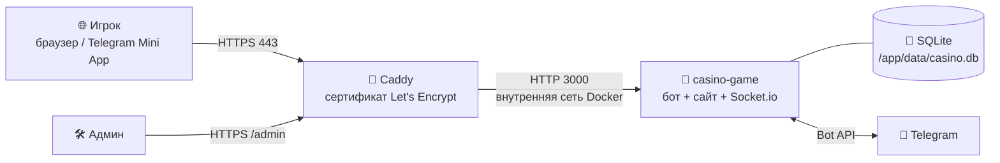

# 🚀 Деплой казино на свой VPS

Подробная инструкция: от чистого сервера до работающего сайта с HTTPS,
Telegram-ботом и автоматическими backup'ами.

> 💡 **Коротко:** нужен VPS с Ubuntu, домен (или бесплатный `sslip.io`) и 10 минут.
> Всё остальное делает `deploy/install.sh`.

---

## 📑 Содержание

1. [Что получится](#что-получится)
2. [Что нужно](#что-нужно)
3. [Шаг 1. Создать VPS](#шаг-1-создать-vps)
4. [Шаг 2. Настроить домен](#шаг-2-настроить-домен)
5. [Шаг 3. Подключиться по SSH](#шаг-3-подключиться-по-ssh)
6. [Шаг 4. Запустить установку](#шаг-4-запустить-установку)
7. [Шаг 5. Проверить сайт](#шаг-5-проверить-сайт)
8. [Шаг 6. Подключить Telegram](#шаг-6-подключить-telegram)
9. [Обновление](#обновление)
10. [Backup и восстановление](#backup-и-восстановление)
11. [Логи и диагностика](#логи-и-диагностика)
12. [Troubleshooting](#troubleshooting)
13. [Безопасность](#безопасность)
14. [Чек-лист](#чек-лист)

---

## Что получится



- `https://ваш-домен` — сайт игры и Mini App;
- `https://ваш-домен/admin` — веб-админка (вход по коду из бота или паролю);
- тот же Telegram-бот работает 24/7;
- база и сертификаты лежат в Docker-томах и переживают пересборку;
- порт `3000` наружу не открыт — только Caddy на `80/443`.

---

## Что нужно

| | Что | Зачем |
|---|-----|-------|
| 🖥 | VPS: **1–2 ГБ RAM**, 1 vCPU, 15–20 ГБ SSD | Docker + Node.js + Python + SQLite |
| 🐧 | **Ubuntu 22.04 / 24.04** (или Debian 12) | Скрипт установки рассчитан на apt |
| 🌍 | Публичный **IPv4** | Чтобы домен указывал на сервер |
| 🔗 | Домен (необязательно) | HTTPS и Telegram Mini App |
| 🤖 | Токен бота от [@BotFather](https://t.me/BotFather) | Бот уже есть: `@JBlackJack_bot` |
| 🆔 | Ваш Telegram ID | `ADMIN_IDS` для входа в админку |

Подойдёт любой провайдер: Timeweb, Aeza, Hetzner, DigitalOcean, Vultr,
REG.RU, Beget и т.п. Главное — **Ubuntu** и публичный IP.

> ⚠️ 1 ГБ RAM хватит для работы, но первая сборка может упасть по памяти.
> Если у VPS 1 ГБ — создайте swap (команды ниже) или берите 2 ГБ.

---

## Шаг 1. Создать VPS

1. Зарегистрируйтесь у провайдера и создайте сервер:
   - ОС: **Ubuntu 24.04 LTS** (или 22.04);
   - RAM: **2 ГБ** (минимум 1 ГБ + swap);
   - диск: **20 ГБ SSD**;
   - публичный IPv4: **включён**.
2. Запишите:
   - IP сервера, например `203.0.113.10`;
   - логин (`root` или `ubuntu`);
   - пароль или SSH-ключ.
3. В панели провайдера проверьте firewall / security group:
   разрешите входящие **22 (SSH), 80 (HTTP), 443 (HTTPS)**.

### Если на VPS 1 ГБ RAM — добавьте swap

```bash
sudo fallocate -l 2G /swapfile
sudo chmod 600 /swapfile
sudo mkswap /swapfile
sudo swapon /swapfile
echo '/swapfile none swap sw 0 0' | sudo tee -a /etc/fstab
free -h
```

---

## Шаг 2. Настроить домен

Нужен **A-рекорд**, который указывает на IP сервера.

### Вариант A. Есть свой домен

В панели регистратора (или Cloudflare) создайте запись:

| Тип | Имя | Значение | TTL |
|-----|-----|----------|-----|
| `A` | `casino` (или `@`) | `203.0.113.10` | 300 / Auto |

Пример: `casino.example.com` → `203.0.113.10`.

Проверка (с домашнего компьютера):

```bash
nslookup casino.example.com
# или
dig +short casino.example.com
```

Должен вернуться IP вашего VPS.

> 🔵 **Cloudflare:** на первом запуске включите **DNS only** (серая тучка),
> чтобы Caddy спокойно выпустил сертификат. После успешного HTTPS можно
> включить прокси (оранжевая тучка) и режим **Full (strict)**.

### Вариант B. Домена нет — используем sslip.io

`sslip.io` — бесплатный DNS: имя содержит IP, и он сразу резолвится в него.

Если IP сервера `203.0.113.10`, домен будет:

```text
203-0-113-10.sslip.io
```

Точки заменяются на дефисы. Проверьте:

```bash
nslookup 203-0-113-10.sslip.io
```

Это полноценный домен для HTTPS и Telegram Mini App. Минус — некрасивый адрес.
Позже можно подключить свой домен и поменять `DOMAIN` в `.env`.

> Для отладки совсем без домена можно указать `DOMAIN=http://203.0.113.10`
> (Caddy будет отдавать сайт по HTTP). Но Telegram Mini App требует HTTPS,
> поэтому для «боевого» режима нужен домен или `sslip.io`.

---

## Шаг 3. Подключиться по SSH

На **своём компьютере** (Windows PowerShell / macOS / Linux):

```bash
ssh root@203.0.113.10
```

Если логин `ubuntu`:

```bash
ssh ubuntu@203.0.113.10
```

При первом подключении подтвердите fingerprint (`yes`) и введите пароль.

Дальше все команды выполняются **на сервере**, если не сказано иное.

Проверьте, что сервер видит интернет:

```bash
curl -fsS https://api.telegram.org >/dev/null && echo "интернет OK"
```

---

## Шаг 4. Запустить установку

### 4.1. Клонировать репозиторий

```bash
sudo apt-get update
sudo apt-get install -y git
git clone https://github.com/JamikKhidirov/CasinoGame.git
cd CasinoGame
```

> Если репозиторий приватный — используйте SSH-ключ
> (`git clone git@github.com:JamikKhidirov/CasinoGame.git`) или
> personal access token.

### 4.2. Запустить скрипт

```bash
sudo bash deploy/install.sh
```

Скрипт спросит:

| Вопрос | Что ввести |
|--------|------------|
| `BOT_TOKEN` | токен из `@BotFather` |
| `ADMIN_IDS` | ваш Telegram ID (число), можно несколько через запятую |
| Пароль админки | придумайте или нажмите Enter — сгенерируется |
| `DOMAIN` | `casino.example.com`, `203-0-113-10.sslip.io` или просто **Enter** — скрипт сам определит IP и возьмёт бесплатный `sslip.io` |

Если `.env` уже существует, скрипт не перезапишет его и спросит только
недостающие значения.

Что произойдёт дальше:

1. установится Docker (если его нет);
2. создастся `.env` с правами `600`;
3. откроются порты `80/443` в `ufw`/`firewalld` (если firewall включён);
4. соберётся Docker-образ (5–10 минут);
5. запустятся `casino-game` и `casino-caddy`;
6. Caddy выпустит HTTPS-сертификат.

В конце скрипт выведет адрес сайта и команды для логов.

### Что именно создаётся

| Файл / контейнер | Назначение |
|------------------|------------|
| `docker-compose.vps.yml` | production-стек: приложение + Caddy |
| `deploy/Caddyfile` | reverse proxy, HTTPS, WebSocket, сжатие |
| `.env` | секреты и настройки (не коммитится) |
| `casino-game` | бот + сайт + Socket.io + SQLite |
| `casino-caddy` | HTTPS на 80/443 |
| `casino_game_data` | том с базой `/app/data/casino.db` |
| `casino_caddy_data` | том с сертификатами |

---

## Шаг 5. Проверить сайт

### На сервере

```bash
# статус контейнеров
sudo docker compose -f docker-compose.vps.yml ps

# health приложения (внутри контейнера, порт 3000 наружу закрыт)
sudo docker compose -f docker-compose.vps.yml exec casino \
  curl -fsS http://localhost:3000/health

# health через Caddy
curl -fsS https://casino.example.com/health
```

Ожидаемый ответ:

```json
{"status":"ok","timestamp":"...","rooms":0,"players":0,"db":"ok"}
```

### В браузере

1. Откройте `https://casino.example.com` — должна открыться главная.
2. Откройте `https://casino.example.com/admin` — форма входа.
3. В Telegram отправьте боту `/site` — придёт кнопка «Открыть сайт».
4. Получите код входа в боте (`/site` → «Войти по коду») и войдите на сайт.

### Если сертификат ещё не готов

Caddy выпускает сертификат 1–2 минуты. Смотрите:

```bash
sudo docker compose -f docker-compose.vps.yml logs -f caddy
```

Признак успеха: `certificate obtained successfully`.

---

## Шаг 6. Подключить Telegram

`WEB_URL` в `.env` уже указывает на ваш домен — бот будет присылать правильные ссылки.

В [@BotFather](https://t.me/BotFather):

1. `/setmenubutton` → выберите бота → URL `https://casino.example.com/`
   → название кнопки, например `🎰 Казино`.
2. `/setdomain` → `casino.example.com` (если BotFather попросит).
3. Проверьте: кнопка меню в чате с ботом открывает сайт **внутри Telegram**.

> Mini App работает только по **HTTPS** на публичном домене.
> `localhost` и `http://IP` Telegram не откроет.

Если меняли `.env` вручную — пересоздайте контейнер, чтобы бот прочитал новые значения:

```bash
sudo docker compose -f docker-compose.vps.yml up -d
```

---

## Обновление

```bash
cd /opt/casino        # или папка, куда клонировали
sudo git pull --ff-only
sudo docker compose -f docker-compose.vps.yml up -d --build
```

- база в томе `casino_game_data` **не удаляется**;
- простой обычно 30–60 секунд;
- если `git pull` ругается на локальные изменения: `sudo git stash`, затем повторите.

### Откат на предыдущую версию

```bash
git log --oneline -10
git checkout <первые-7-символов-коммита>
sudo docker compose -f docker-compose.vps.yml up -d --build
```

Вернуться на актуальную версию: `git checkout main`.

---

## Backup и восстановление

### Ручной backup

```bash
cd /opt/casino
sudo bash deploy/backup.sh
```

Скрипт:

- делает **целостную** копию SQLite через `sqlite3.backup()` на работающем контейнере;
- сжимает её в `backups/casino-YYYYMMDD-HHMMSS.db.gz`;
- удаляет копии старше `KEEP` дней (по умолчанию 14).

Свой каталог и срок хранения:

```bash
sudo BACKUP_DIR=/mnt/backups KEEP=30 bash deploy/backup.sh
```

### Автоматический backup (cron)

```bash
sudo crontab -e
```

Добавьте строку:

```cron
0 3 * * * /bin/bash /opt/casino/deploy/backup.sh >> /var/log/casino-backup.log 2>&1
```

Проверить:

```bash
sudo crontab -l
sudo tail -n 20 /var/log/casino-backup.log
ls -lh /opt/casino/backups
```

### Восстановление

```bash
cd /opt/casino

# 1. Остановить приложение (Caddy можно не трогать)
sudo docker compose -f docker-compose.vps.yml stop casino

# 2. Распаковать нужную копию
gunzip -c backups/casino-20261117-030000.db.gz > /tmp/restore.db

# 3. Удалить старые WAL-файлы, чтобы не смешать состояния
sudo docker run --rm -v casino_game_data:/data alpine:3.20 \
  sh -c 'rm -f /data/casino.db-wal /data/casino.db-shm'

# 4. Положить базу в том
sudo docker cp /tmp/restore.db casino-game:/app/data/casino.db

# 5. Запустить
sudo docker compose -f docker-compose.vps.yml start casino
curl -fsS https://ваш-домен/health
```

> `docker cp` в остановленный контейнер работает. Если контейнера нет —
> используйте временный: `docker run --rm -v casino_game_data:/data -v /tmp:/src alpine cp /src/restore.db /data/casino.db`.

---

## Логи и диагностика

```bash
cd /opt/casino

# все логи
sudo docker compose -f docker-compose.vps.yml logs -f

# только приложение (бот + сайт)
sudo docker compose -f docker-compose.vps.yml logs -f casino

# только Caddy (сертификаты, HTTP-коды)
sudo docker compose -f docker-compose.vps.yml logs -f caddy

# последние 200 строк без зависания
sudo docker compose -f docker-compose.vps.yml logs --tail=200 casino

# статус и здоровье
sudo docker compose -f docker-compose.vps.yml ps
sudo docker stats --no-stream
df -h
free -h
```

Полезные проверки:

```bash
# порты слушаются?
sudo ss -tlnp | grep -E ':(80|443)\b'

# DNS указывает на этот сервер?
getent hosts ваш-домен

# приложение живое изнутри?
sudo docker compose -f docker-compose.vps.yml exec casino \
  curl -fsS http://localhost:3000/health
```

---

## Troubleshooting

### Сайт не открывается, в логах Caddy `no such host`

DNS ещё не обновился или A-запись неверная.

```bash
dig +short ваш-домен
# должно совпасть с IP сервера
```

Подождите 5–15 минут (TTL), проверьте запись у регистратора.

### Caddy: `connection refused` / `502`

Приложение не запустилось или не прошло healthcheck.

```bash
sudo docker compose -f docker-compose.vps.yml ps
sudo docker compose -f docker-compose.vps.yml logs --tail=200 casino
```

Частые причины: неверный `BOT_TOKEN`, не хватило RAM при сборке, занят порт.

### Сертификат не выпускается

Проверьте по порядку:

1. Домен резолвится в IP сервера (`dig +short`).
2. Провайдер и `ufw` пропускают **80** и **443** снаружи.
3. Нет другого веб-сервера на `80/443`:
   ```bash
   sudo ss -tlnp | grep -E ':(80|443)\b'
   ```
   Если там nginx/apache — остановите их:
   `sudo systemctl disable --now nginx apache2`.
4. В логах Caddy видно причину:
   ```bash
   sudo docker compose -f docker-compose.vps.yml logs --tail=100 caddy
   ```
5. Let's Encrypt ограничивает 5 неудачных попыток в час — после исправления
   подождите или используйте staging (см. документацию Caddy).

### `port is already allocated`

Порты 80/443 заняты. Освободите их (см. выше) и перезапустите:

```bash
sudo docker compose -f docker-compose.vps.yml up -d
```

### Бот молчит

```bash
sudo docker compose -f docker-compose.vps.yml logs -f casino | grep -i -E 'bot|telegram|error'
```

- проверьте `BOT_TOKEN` в `.env`;
- токен мог быть отозван в `@BotFather` — выпустите новый;
- на сервере должен быть доступ к `api.telegram.org` (некоторые провайдеры блокируют — проверьте `curl -I https://api.telegram.org`).

После правки `.env`:

```bash
sudo docker compose -f docker-compose.vps.yml up -d
```

### Mini App не открывается из Telegram

- URL должен быть **HTTPS** и с валидным сертификатом;
- `WEB_URL` в `.env` должен совпадать с реальным адресом;
- в `@BotFather` → `/setmenubutton` указан тот же URL;
- откройте сайт в обычном браузере: если там ошибка сертификата,
  Telegram тоже не откроет.

### `git pull` не работает / репозиторий приватный

Настройте доступ к GitHub на сервере:

```bash
ssh-keygen -t ed25519 -C "vps-casino"
cat ~/.ssh/id_ed25519.pub
```

Добавьте ключ в GitHub → Settings → SSH keys, затем используйте
`git clone git@github.com:...`.

### Кончилось место

```bash
df -h
sudo docker system df
# безопасная очистка неиспользуемых образов и кэша сборки
sudo docker image prune -f
sudo docker builder prune -f
```

Не удаляйте тома `casino_game_data` и `casino_caddy_data` — там база и сертификаты.

### База «обнулилась»

Скорее всего контейнер запущен с другим томом или выполнен `down -v`.
Проверьте:

```bash
sudo docker volume ls | grep casino
sudo docker compose -f docker-compose.vps.yml config | grep -A2 volumes
```

Том должен называться `casino_game_data`.

---

## Безопасность

| | Мера |
|---|------|
| 🔥 | Наружу открыты только `22`, `80`, `443`; порт `3000` закрыт |
| 🔑 | Вход в админку — одноразовый код из бота для `ADMIN_IDS` + запасной пароль |
| 🙈 | `.env` с правами `600`, не попадает в git и Docker-образ |
| 🧱 | HTTPS с HSTS, автоматическое продление сертификата |
| 👤 | Процессы в контейнере работают от непривилегированного пользователя `bot` |
| 🚦 | Rate limit на вход, донаты, выводы и игровые действия |
| 💾 | Регулярные backup'ы SQLite |
| 🎛 | Режим «Развлечение» полностью отключает денежные операции на сервере |

Рекомендуется дополнительно:

```bash
# вход по SSH-ключу вместо пароля
sudo nano /etc/ssh/sshd_config
# PasswordAuthentication no
sudo systemctl restart ssh

# автообновления безопасности
sudo apt-get install -y unattended-upgrades
sudo dpkg-reconfigure --priority=low unattended-upgrades
```

Никогда не публикуйте `.env`, `backups/` и токен бота.

---

## Чек-лист

- [ ] VPS создан, IP записан, 80/443 открыты у провайдера
- [ ] A-запись домена указывает на IP (или используется `sslip.io`)
- [ ] `deploy/install.sh` выполнен без ошибок
- [ ] `https://домен/health` возвращает `"status":"ok"`
- [ ] Сайт открывается, вход по коду из бота работает
- [ ] `/admin` пускает по коду из бота (и по паролю, если он задан)
- [ ] В `@BotFather` настроен `/setmenubutton` на HTTPS-адрес
- [ ] Mini App открывается внутри Telegram
- [ ] `deploy/backup.sh` выполнен вручную и добавлен в cron
- [ ] Проверены логи `casino` и `caddy` без ошибок
- [ ] `APP_MODE` выставлен нужный (`business` / `fun`) в `/admin → Настройки`

---

## Нужна помощь с самим деплоем?

Я не могу подключиться к вашему серверу без доступа. Есть два пути:

1. **Вы выполняете сами** — команды из этой инструкции (10–15 минут).
2. **Я разворачиваю** — пришлите IP сервера и способ входа
   (пользователь + пароль или SSH-ключ). После деплоя смените пароль
   и/или отзовите временный ключ.

В обоих случаях после запуска проверьте чек-лист выше.

---

<div align="center">

[📖 README](../README.md) · [📦 DEPLOY](../DEPLOY.md) · [🏗 ARCHITECTURE](../ARCHITECTURE.md) · [🔗 API](../API.md)

<a href="#top">⬆ Наверх</a>

</div>
